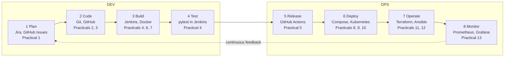
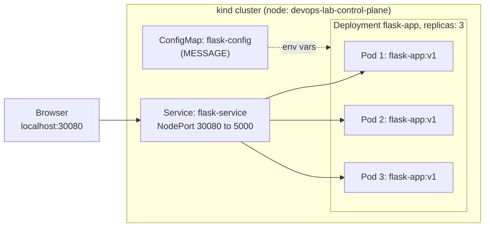

# DevOps Practicals — Theory, Commands & Viva Guide

Oct 31, 2026 · @Tejas

## How to present

Present every practical as one story: **one small Flask app travels through the whole DevOps lifecycle** — written and versioned with Git, tested automatically by Jenkins and GitHub Actions, packaged with Docker, run as a multi-container stack with Compose, orchestrated by Kubernetes, with servers provisioned by Terraform, configured by Ansible and monitored by Prometheus and Grafana.

For each practical, follow the same 4-step pattern (about 3–5 minutes):

1. **Aim (1 line)** — "This practical shows how \_\_\_ automates \_\_\_."
2. **Concept (2–3 lines)** — what the tool is and which lifecycle phase it belongs to.
3. **Demo** — run the commands, and say what each important command does *before* pressing Enter.
4. **Result + conclusion** — point at the proof on screen (green tick, `Running` pods, `changed=0`, a dashboard) and say what it proves.

Viva tips:

- Answer with **definition → example from your demo**. E.g. "Idempotency means running it again changes nothing — you saw my second Ansible run show `changed=0`."
- If you don't know, connect it to something you do know instead of guessing.
- Know the 3 numbers in your setup: app port **5000 inside the container, 8000 outside**; Kubernetes NodePort **30080**; Grafana **3000**, Prometheus **9090**.

## Practical 1 — DevOps lifecycle and tools

**DevOps** is a culture plus a set of practices and tools that brings Development (Dev) and IT Operations (Ops) together, so software is delivered **faster, more often and more reliably** through automation, collaboration and continuous feedback.



The lifecycle is drawn as an infinity loop because it never ends: what Monitor finds goes back into Plan for the next cycle.

### The phases in one line each

| Phase | Goal | Tools (yours in bold) |
| --- | --- | --- |
| Plan | Decide what to build, track tasks | Jira, Trello, GitHub Issues |
| Code | Write and version the code | **Git, GitHub** |
| Build | Turn code into a runnable artifact | **Jenkins, Docker**, Maven, npm |
| Test | Check it automatically | **pytest**, Selenium, JUnit |
| Release | Approve and package a version for deployment | **GitHub Actions**, Jenkins, GitLab CI |
| Deploy | Put it on servers | **Docker Compose, Kubernetes** |
| Operate | Manage infrastructure and configuration | **Terraform, Ansible** |
| Monitor | Watch health and performance | **Prometheus, Grafana**, ELK |

### Key terms

- **CI — Continuous Integration:** every push is automatically built and tested, so bugs are caught early. *(Jenkins, GitHub Actions)*
- **Continuous Delivery:** every change that passes CI is always *ready* to deploy; a human clicks the final deploy.
- **Continuous Deployment:** every change that passes CI is deployed to production *automatically*, with no human step.
- **Infrastructure as Code (IaC):** servers are described in files, not created by hand. *(Terraform)*
- **Shift left:** testing and security happen early in the pipeline, not at the end.

### Viva answers

- **What is DevOps and why is it needed?** It joins Dev and Ops teams with shared responsibility and automation. Without it, developers "throw code over the wall", releases are slow and failures are blamed on each other. DevOps gives faster releases, fewer failures and faster recovery.
- **CI vs Continuous Delivery vs Continuous Deployment?** CI = build + test on every commit. Delivery = always release-ready, deploy needs approval. Deployment = goes to production automatically.
- **Why the infinity loop?** Each phase feeds the next and Monitor feeds back into Plan — improvement is continuous, never "finished".
- **DevOps vs Agile?** Agile speeds up *development* with short sprints; DevOps extends that speed to *deployment and operations*.
- **Benefits?** Faster time to market, fewer deployment failures, quicker rollback and recovery, better collaboration.

## Practical 2 & 3 — Git and GitHub

**Git** is a *distributed version control system*: it records every change to your code as a commit, and every developer has the full history on their own machine. **GitHub** is a website that hosts Git repositories online and adds collaboration features — pull requests, issues, Actions.

### Concepts to know

- **Three areas:** *working directory* (files you edit) → `git add` → *staging area* (what goes in the next commit) → `git commit` → *repository* (permanent history).
- **Commit:** a snapshot with a unique ID (hash), author, date and message.
- **Branch:** a separate line of work. You build a feature on `feature-update` without touching `main`.
- **Merge:** joins a branch back into another branch.
- **Pull request (PR):** a request on GitHub to merge a branch, so others can review the diff first.
- **Merge conflict:** both branches changed the *same line* differently, so Git can't decide and asks you.
- **Remote / origin:** the copy of the repo on GitHub; `origin` is its default name.

### Commands explained

| Command | What it does |
| --- | --- |
| `git config --global user.name "Your Name"` | Sets the name stamped on every commit (`--global` = for all repos on this machine) |
| `git config --global init.defaultBranch main` | New repos start on a branch called `main` instead of `master` |
| `git config --list` | Shows all saved settings |
| `ssh-keygen -t ed25519 -C "email"` | Creates an SSH key pair: private key stays on your PC, public key (`.pub`) goes to GitHub |
| `ssh -T git@github.com` | Tests the SSH login to GitHub |
| `git init` | Turns the current folder into a Git repository (creates the hidden `.git` folder) |
| `git add .` | Moves all changed files into the staging area |
| `git commit -m "msg"` | Saves the staged snapshot permanently with a message |
| `git commit -am "msg"` | Adds all already-tracked changed files and commits in one step |
| `git branch -M main` | Renames the current branch to `main` |
| `git remote add origin <url>` | Links the local repo to the GitHub repo and names it `origin` |
| `git push -u origin main` | Uploads commits to GitHub; `-u` remembers the link so later just `git push` works |
| `git checkout -b feature-update` | Creates a new branch and switches to it |
| `git checkout main` | Switches back to the `main` branch |
| `git pull origin main` | Downloads new commits from GitHub **and** merges them (= fetch + merge) |
| `git merge feature-title` | Merges that branch into the current branch |
| `git diff` | Shows line-by-line changes (and conflict markers during a conflict) |
| `git checkout --theirs <file>` | During a conflict, keeps the incoming branch's version of the file |
| `git branch -d feature-update` | Deletes a branch that is already merged |
| `git log --oneline --graph` | Shows the history, one line per commit, with branch lines drawn |
| `git status` | Shows which files are modified, staged or conflicted |
| `sed -i 's/old/new/' file` | Not Git — a Linux command that replaces text in a file (used to make quick code changes) |

Conflict markers you will show:

```text
<<<<<<< HEAD                          <- your current branch (main)
    <h1>DevOps Lab App (Main)</h1>
=======
    <h1>DevOps Lab App (Feature)</h1>
>>>>>>> feature-title                  <- the branch being merged
```

### Viva answers

- **Git vs GitHub?** Git is the version-control *tool* that runs on your PC. GitHub is a *hosting service* for Git repos with collaboration features. You can use Git without GitHub.
- **Why SSH instead of HTTPS?** SSH uses a key pair, so no password or token is typed on each push, and the private key never leaves your machine — more secure and convenient.
- **What does `git config --global` do?** Saves a setting for every repository of the current user (in `~/.gitconfig`). Without `--global` it applies to one repo only.
- **What is a distributed VCS?** Every clone has the full history, so you can commit, branch and view history offline; there is no single point of failure. (Centralised example: SVN.)
- **`git merge` vs `git rebase`?** Merge joins two branches with a merge commit and keeps the history as it happened. Rebase replays your commits on top of the other branch, giving a straight, linear history but rewriting commits. Never rebase shared branches.
- **What is a merge conflict and how do you resolve it?** Two branches changed the same lines. Git marks them with `<<<<<<<`, `=======`, `>>>>>>>`. You pick the correct version (edit the file or use `--ours`/`--theirs`), then `git add` and `git commit`.
- **Purpose of a pull request?** Code review and discussion before merging, plus a place where CI checks run automatically.
- **`git fetch` vs `git pull`?** Fetch only downloads new commits without changing your files. Pull = fetch + merge into your current branch.
- **Clone vs fork?** Clone copies a repo to your PC. Fork copies a repo to *your GitHub account*.
- **What is `.gitignore`?** A list of files Git should not track — here `venv/` and `__pycache__/`.
- **What is HEAD?** A pointer to the commit/branch you are currently on.

## Practical 4 — Jenkins (automating build and test)

**Jenkins** is an open-source **automation server** written in Java. It watches your repository and automatically runs jobs — build, test, deploy — whenever code changes. That is **Continuous Integration**.

### Concepts to know

- **Job / Item:** a task Jenkins runs. Yours is `flask-pipeline`.
- **Freestyle job:** configured by clicking in the UI. **Pipeline job:** defined in code (a `Jenkinsfile`).
- **Jenkinsfile:** "pipeline as code" — the pipeline is stored in Git next to the app, so it is versioned and reviewed like code.
- **Declarative vs scripted pipeline:** declarative (yours, `pipeline { }`) has a fixed, readable structure; scripted is plain Groovy code, more flexible but harder to read.
- **Stage / step:** a stage is a named phase (Build, Test); steps are the commands inside it.
- **Controller and agents:** the controller (master) schedules jobs and serves the UI; agents (nodes) actually run the builds. `agent any` = run on any free agent.
- **Workspace:** the folder where Jenkins checks out your code for a build.
- **Plugins:** Jenkins features come from plugins (Git, Pipeline, …) — installed with "Install suggested plugins".

### Your Jenkinsfile, line by line

| Line | Meaning |
| --- | --- |
| `pipeline { }` | Start of a declarative pipeline |
| `agent any` | Run on any available Jenkins agent |
| `triggers { pollSCM('* * * * *') }` | Check GitHub every minute; start a build if there's a new commit (cron format: minute hour day month weekday) |
| `stage('Build')` | Creates a venv and installs `requirements.txt` |
| `stage('Test')` | Runs `pytest -v`; if a test fails the build turns red |
| `sh '...'` | Runs a shell command on the agent |
| `. venv/bin/activate` | Activates the venv (`.` = `source` in plain sh) |
| `post { success / failure }` | Runs after all stages, depending on the result |

### Commands explained

| Command | What it does |
| --- | --- |
| `docker run -d -p 8080:8080 -p 50000:50000 --name jenkins -v jenkins_home:/var/jenkins_home jenkins/jenkins:lts` | Starts Jenkins in a container. `-d` background, `-p 8080` web UI, `-p 50000` port for agents to connect, `-v` keeps Jenkins data in a volume so it survives restarts, `lts` = Long Term Support version |
| `docker exec -u root jenkins bash -c "apt-get install -y python3 python3-venv"` | Runs a command inside the Jenkins container as root, installing Python so the pipeline can run pytest |
| `docker exec jenkins cat /var/jenkins_home/secrets/initialAdminPassword` | Prints the one-time password that unlocks Jenkins the first time |
| Build Now → Console Output | Runs the job manually and shows its full log |

### Viva answers

- **What is Jenkins and why is it used?** An open-source automation server for CI/CD. It automatically builds and tests code on every change, so bugs are found early and releases are repeatable.
- **Freestyle project vs Pipeline job?** Freestyle is configured in the UI with simple build steps — good for small tasks. A Pipeline is written as code in a Jenkinsfile, supports multiple stages, is stored in Git and survives Jenkins restarts.
- **What is a build trigger? Types?** What starts a build automatically: **Poll SCM** (Jenkins checks the repo on a schedule — yours), **GitHub webhook** (GitHub notifies Jenkins instantly on push), **Build periodically** (cron, e.g. nightly), **after another project**, or **manual**.
- **What is a Jenkins agent/node?** A machine or container that executes builds for the controller, so many builds can run in parallel on different OSes.
- **Poll SCM vs webhook?** Polling asks "anything new?" repeatedly (simple, works on localhost). A webhook is pushed by GitHub immediately (faster, needs Jenkins reachable from the internet).
- **What does `* * * * *` mean?** Cron syntax: minute, hour, day-of-month, month, day-of-week — all stars = every minute. `H/5 * * * *` = every 5 minutes.
- **Why is the pipeline red when a test fails?** `pytest` exits with a non-zero code; any `sh` step that returns non-zero fails the stage and the build.
- **Why port 50000?** It is the port agents use to connect to the controller (JNLP/inbound agents).

## Practical 5 — GitHub Actions (CI/CD pipeline)

**GitHub Actions** is a CI/CD service built into GitHub. A **workflow** written in YAML inside `.github/workflows/` runs automatically on repository events such as a push. Nothing has to be installed — GitHub provides the machines (runners).

### Concepts to know

- **Workflow:** the whole automated process (one YAML file).
- **Event / trigger:** what starts it — `push`, `pull_request`, `schedule`, `workflow_dispatch` (manual).
- **Job:** a group of steps that runs on one runner. Jobs run **in parallel** unless linked with `needs`.
- **Step:** a single command (`run:`) or a reusable action (`uses:`).
- **Action:** a ready-made step from the Marketplace, e.g. `actions/checkout`.
- **Runner:** the virtual machine that executes a job. `ubuntu-latest` is a fresh Ubuntu VM hosted by GitHub, deleted after the job.

### Your workflow, line by line

| Line | Meaning |
| --- | --- |
| `name: CI/CD Pipeline` | Name shown in the Actions tab |
| `on: push: branches: [ main ]` | Run on every push to `main` |
| `jobs: build-and-test:` | First job: the CI part |
| `runs-on: ubuntu-latest` | Use a GitHub-hosted Ubuntu VM |
| `uses: actions/checkout@v5` | Downloads your repo code onto the runner |
| `uses: actions/setup-python@v6` with `python-version: '3.12'` | Installs Python 3.12 on the runner |
| `run: pip install -r requirements.txt` | Installs Flask and pytest |
| `run: pytest -v` | Runs the tests; a failure stops the pipeline |
| `docker-build:` with `needs: build-and-test` | Second job; runs only if the first succeeds |
| `docker build -t flask-app:latest .` | Builds the Docker image (the CD/packaging part) |
| `docker run -d -p 8000:5000 ...` then `curl .../health` | Smoke test: starts the container and checks it responds |

### Viva answers

- **What is a YAML workflow file and where must it be?** A file describing triggers, jobs and steps in YAML. It must be in `.github/workflows/` with a `.yml` or `.yaml` extension, or GitHub ignores it.
- **Job vs step?** A job is a set of steps that runs on its own runner (separate VM). Steps are individual commands inside a job and share that job's files.
- **What are runners?** Machines that execute jobs. **GitHub-hosted** runners are fresh VMs provided by GitHub; **self-hosted** runners are your own machines registered with GitHub.
- **How do you make one job wait for another?** `needs: <job-name>` — your `docker-build` has `needs: build-and-test`.
- **What is `uses` vs `run`?** `uses` runs a pre-built action; `run` executes a shell command.
- **How are passwords stored?** As encrypted **Secrets** (Settings → Secrets and variables → Actions), used as `${{ secrets.NAME }}` — never written in the YAML.
- **Jenkins vs GitHub Actions?** Jenkins is self-hosted, you maintain the server and plugins, very flexible. Actions is hosted by GitHub, zero setup, configured with YAML in the repo.
- **GitLab CI equivalent?** A `.gitlab-ci.yml` at the repo root with `stages:` (build, test, deploy) and jobs assigned to each stage.

## Practical 6 & 7 — Docker and Dockerfile

**Docker** packages an application with everything it needs (code, Python, libraries) into a **container** that runs the same on any machine. It uses OS-level virtualization: containers share the host's kernel, so they start in seconds and are much lighter than virtual machines.

### Concepts to know

- **Image:** a read-only template (blueprint) — e.g. `flask-app:v1`, `nginx`.
- **Container:** a running instance of an image. One image → many containers.
- **Dockerfile:** the text recipe used to build an image.
- **Layer:** each Dockerfile instruction creates a cached layer; unchanged layers are reused, so rebuilds are fast.
- **Registry:** where images are stored and shared — Docker Hub is the public one.
- **Docker Engine:** the background service (daemon) that builds and runs containers. The `docker` command is the client that talks to it.
- **Port mapping `-p 8000:5000`:** host port 8000 → container port 5000 (always *host:container*).
- **Volume:** storage outside the container so data survives when the container is deleted.

### Container vs virtual machine

|  | Container | Virtual machine |
| --- | --- | --- |
| Virtualizes | Operating system (shares host kernel) | Hardware (runs its own full OS) |
| Size | MBs | GBs |
| Start time | Seconds | Minutes |
| Isolation | Process-level, lighter | Stronger, full OS |

### Your Dockerfile, line by line

| Instruction | Meaning |
| --- | --- |
| `FROM python:3.12-slim` | Base image: a small Linux with Python 3.12 |
| `WORKDIR /app` | Sets (and creates) the working folder inside the image |
| `COPY . .` | Copies project files from your folder into `/app` |
| `RUN pip install -r requirements.txt` | Runs at **build time**: installs Flask and pytest into the image |
| `EXPOSE 5000` | Documents the port the app listens on (does not publish it) |
| `CMD ["python", "app.py"]` | Runs at **container start**: launches the app |
| `.dockerignore` | Files not copied into the image (`venv`, `.git`) — smaller, faster builds |

### Commands explained

| Command | What it does |
| --- | --- |
| `docker --version` | Shows the installed Docker version |
| `docker run hello-world` | Downloads and runs a test image to prove Docker works |
| `docker pull nginx` | Downloads an image from Docker Hub |
| `docker images` | Lists images on your machine |
| `docker run -d -p 8888:80 --name web nginx` | Creates and starts a container: `-d` background, `-p` port mapping, `--name` a friendly name |
| `docker ps` / `docker ps -a` | Running containers / all containers including stopped |
| `docker logs web` | Shows the container's output |
| `docker exec -it web bash` | Opens a shell inside a running container (`-i` interactive, `-t` terminal) |
| `docker stop web` / `docker start web` | Gracefully stops / restarts a container |
| `docker inspect web` | Full details of a container (state, network, mounts) in JSON |
| `docker rm web` | Deletes a stopped container |
| `docker rmi nginx` | Deletes an image |
| `docker system df` | Disk space used by images, containers, volumes |
| `docker build -t flask-app:v1 .` | Builds an image from the Dockerfile in `.`; `-t` gives it name:tag |
| `docker tag` / `docker push` | Renames an image for a registry and uploads it to Docker Hub |

### Viva answers

- **How does a container differ from a VM?** A VM virtualizes hardware and runs a full guest OS; a container shares the host kernel and isolates only the process — lighter, faster, smaller.
- **`docker stop` vs `docker kill`?** Stop sends SIGTERM and waits (10 s) so the app shuts down cleanly, then SIGKILL. Kill sends SIGKILL immediately.
- **What is an image layer?** Each instruction in the Dockerfile adds a read-only layer; layers are cached and shared between images, saving time and disk.
- **What does `-d` do?** Detached mode — the container runs in the background and returns the terminal.
- **Image vs container?** Image = blueprint (read-only). Container = running instance with a writable layer on top.
- **WORKDIR and EXPOSE?** WORKDIR sets the folder where later commands run; EXPOSE documents the app's port (you still need `-p` to publish it).
- **Why is layer caching important?** Unchanged steps are skipped on rebuild. Put rarely changing steps (installing dependencies) before often-changing ones (copying code).
- **CMD vs ENTRYPOINT?** CMD is the default command and is easily overridden (`docker run image other-cmd`). ENTRYPOINT is the fixed executable; extra arguments are passed to it.
- **RUN vs CMD?** RUN executes while *building* the image; CMD executes when the *container starts*.
- **COPY vs ADD?** Both copy files; ADD can also extract tar files and download URLs. Prefer COPY.

## Practical 8 — Docker Compose

**Docker Compose** defines and runs a **multi-container** application from one YAML file (`docker-compose.yml`). Instead of several long `docker run` commands, one `docker compose up` creates every container, the network between them and the volumes.

### How your app works

The browser hits the **web** container (Flask) on port 8000. Flask connects to the **redis** container using the hostname `redis` — Compose puts both containers on one network where each service name works as a hostname (built-in DNS). Every page visit runs `INCR visits` in Redis, and the counter is stored in the `redis-data` volume, so it survives `docker compose down` / `up`.

### Your docker-compose.yml, line by line

| Line | Meaning |
| --- | --- |
| `services:` | List of containers in the app |
| `web: build: .` | Build the web image from the Dockerfile in this folder |
| `ports: - "8000:5000"` | Host port 8000 → container port 5000 |
| `depends_on: - redis` | Start Redis before web |
| `redis: image: redis:7-alpine` | Use the ready-made Redis image (Alpine = tiny Linux) |
| `volumes: - redis-data:/data` | Store Redis data in a named volume |
| `volumes: redis-data:` (bottom) | Declares that named volume |

### Commands explained

| Command | What it does |
| --- | --- |
| `docker compose up -d --build` | Builds images if needed and starts all services in the background |
| `docker compose ps` | Lists this project's containers and their ports |
| `docker compose logs web` | Shows logs of one service |
| `docker compose down` | Stops and removes containers and the network (volumes stay) |
| `docker compose down -v` | Also deletes the volumes — the visit count resets |
| `docker compose up -d --scale web=3` | Runs 3 copies of a service (needs a port range or no fixed host port) |

### Viva answers

- **What problem does Compose solve?** Running multi-container apps by hand needs many long `docker run` commands plus networks and volumes in the right order. Compose puts it all in one versioned file and starts or stops everything with one command.
- **Purpose of `depends_on`?** Controls start order — Redis starts before web. It does not wait until Redis is *ready*; for that you add a `healthcheck` with `condition: service_healthy`.
- **Named volume vs bind mount?** A named volume (`redis-data:/data`) is managed by Docker and stored in Docker's area — best for databases. A bind mount (`./prometheus.yml:/etc/...` in Practical 13) maps a specific host file/folder — best for config files and live code.
- **How do you scale a service?** `docker compose up -d --scale web=3`.
- **How do containers find each other?** Compose creates a network and each service name (`redis`) becomes a DNS hostname inside it.
- **`docker compose` vs `docker-compose`?** The old v1 tool was a separate Python program `docker-compose`; v2 is a Docker CLI plugin used as `docker compose`. The YAML is the same.
- **Compose vs Kubernetes?** Compose runs containers on one machine (development, small apps). Kubernetes orchestrates containers across many machines with self-healing, scaling and rolling updates.

## Practical 9 & 10 — Kubernetes

**Kubernetes (K8s)** is an open-source **container orchestration** platform from Google. You tell it the *desired state* ("run 3 copies of flask-app:v1") and it keeps the cluster in that state — scheduling containers onto machines, restarting failed ones, scaling and rolling out updates.



### Architecture

- **Control plane** (the brain): **API server** (front door; `kubectl` talks to it), **etcd** (key-value database storing the cluster state), **scheduler** (picks a node for each new pod), **controller manager** (loops that keep actual state = desired state).
- **Worker node** (runs the apps): **kubelet** (agent that starts pods on the node), **kube-proxy** (network rules for Services), **container runtime** (containerd).
- **kind** = "Kubernetes IN Docker": each node is a Docker container, so a real cluster runs on your laptop. (Minikube is an alternative.)
- **kubectl** = the command-line tool for talking to the cluster.

### Objects you used

| Object | What it is |
| --- | --- |
| **Pod** | Smallest deployable unit: one or more containers sharing an IP and storage |
| **ReplicaSet** | Keeps an exact number of identical pods running |
| **Deployment** | Manages ReplicaSets; adds rolling updates and rollback. You create this, it creates the rest |
| **Service** | A stable IP/DNS name and port in front of changing pods, with load-balancing |
| **ConfigMap** | Non-secret settings (your `MESSAGE`) injected into pods as environment variables |
| **Label / selector** | Tags (`app: flask-app`) that link a Service and Deployment to their pods |

### Your manifests explained

| File | Key lines |
| --- | --- |
| `kind-config.yaml` | `extraPortMappings 30080 → 30080` exposes the node's port 30080 on your PC, so the browser can reach the NodePort |
| `configmap.yaml` | `kind: ConfigMap`, `data: MESSAGE: "Hello from Kubernetes!"` |
| `deployment.yaml` | `replicas: 3`, `selector.matchLabels: app: flask-app` (which pods it owns), `template` (the pod blueprint), `image: flask-app:v1`, `containerPort: 5000`, `envFrom: configMapRef` (loads the ConfigMap as env vars) |
| `service.yaml` | `type: NodePort`, `selector: app: flask-app`, `port: 80` (service port), `targetPort: 5000` (container port), `nodePort: 30080` (port on the node) |

Every manifest has the same 4 top-level fields: `apiVersion`, `kind`, `metadata` (name, labels), `spec` (desired state).

### Commands explained

| Command | What it does |
| --- | --- |
| `kind create cluster --name devops-lab --config kind-config.yaml` | Creates a local cluster (a Docker container acting as the node) |
| `kubectl wait --for=condition=Ready nodes --all` | Waits until the node is ready to run pods |
| `kubectl cluster-info` / `kubectl get nodes` | Shows the API server address / the nodes and their status |
| `kubectl run nginx-pod --image=nginx` | Creates a single pod imperatively (by command, not file) |
| `kubectl get pods` (`-o wide`) | Lists pods (`-o wide` adds pod IP and node) |
| `kubectl describe pod nginx-pod` | Full details + **Events** (scheduled, pulled, started) — first place to debug |
| `kind load docker-image flask-app:v1 --name devops-lab` | Copies your local image into the kind node (no registry needed) |
| `kubectl apply -f deployment.yaml` | Creates or updates objects from a file (declarative) |
| `kubectl get all` | Lists pods, services, deployments, replicasets |
| `kubectl rollout status deployment/flask-app` | Waits and reports until the rollout finishes |
| `kubectl delete pod <name>` | Deletes a pod — the Deployment immediately creates a replacement (self-healing) |
| `kubectl scale deployment flask-app --replicas=5` | Changes the number of pods |
| `kubectl set image deployment/flask-app flask-app=flask-app:v2` | Rolling update to a new image |
| `kubectl rollout history deployment/flask-app` | Lists revisions |
| `kubectl rollout undo deployment/flask-app` | Rolls back to the previous revision |
| `kubectl logs deployment/flask-app` | Shows a pod's logs |
| `kind delete cluster --name devops-lab` | Deletes the whole cluster |

### Viva answers

- **Why is a Pod the smallest unit, not a container?** A pod wraps one or more tightly coupled containers that must share the same network IP, ports and volumes and be scheduled together (e.g. app + log sidecar). Kubernetes manages pods, not bare containers.
- **Deployment vs ReplicaSet?** A ReplicaSet only keeps N pods running. A Deployment manages ReplicaSets and adds rolling updates, rollback and revision history — on an update it creates a new ReplicaSet and scales the old one down.
- **ClusterIP vs NodePort vs LoadBalancer?** ClusterIP (default) = reachable only inside the cluster. NodePort = opens a port (30000–32767) on every node, reachable from outside — yours is 30080. LoadBalancer = asks the cloud provider for an external load balancer with a public IP (EKS/GKE/AKS).
- **How does Kubernetes self-heal?** Controllers constantly compare desired state with actual state. If a pod dies or is deleted, the ReplicaSet creates a new one; if a node fails, pods are rescheduled on other nodes; failing liveness probes restart containers.
- **ConfigMap vs Secret?** Both inject config into pods. ConfigMap is for plain settings; Secret is for passwords and tokens (base64-encoded, can be encrypted at rest, access-restricted).
- **How does a rolling update work?** New pods (v2) are started a few at a time; old pods (v1) are stopped only when new ones are ready — zero downtime. Controlled by `maxSurge` and `maxUnavailable`.
- **How do you roll back?** `kubectl rollout undo deployment/flask-app` (or `--to-revision=N`). You saw the page go from v2 back to v1.
- **Resource requests vs limits?** Request = guaranteed minimum CPU/memory the scheduler reserves. Limit = maximum allowed; over the memory limit the container is killed (OOMKilled), over CPU it is throttled.
- **Imperative vs declarative?** Imperative = commands (`kubectl run`). Declarative = YAML files + `kubectl apply` describing the final state — repeatable and stored in Git.
- **What is a namespace?** A virtual partition of the cluster to separate teams/environments. You used `default`.

## Practical 11 — Terraform (Infrastructure as Code)

**Terraform** (by HashiCorp) is an **Infrastructure as Code** tool: you *declare* the infrastructure you want in `.tf` files written in **HCL** (HashiCorp Configuration Language), and Terraform creates, changes or deletes real resources to match. The same workflow works for AWS, Azure, GCP, Kubernetes or — in your demo — Docker, so no cloud account or cost is needed.

### Concepts to know

- **Declarative:** you describe the *end result* ("one nginx container on port 8081"), not the steps.
- **Provider:** a plugin that knows how to talk to one platform's API — `kreuzwerker/docker` here, `hashicorp/aws` for EC2.
- **Resource:** one piece of infrastructure (`docker_image`, `docker_container`; on AWS `aws_instance`).
- **State file (`terraform.tfstate`):** Terraform's record of what it created and the real IDs. It compares state with your code to decide what to change.
- **Plan:** a preview of changes — `+` create, `~` modify, `-` destroy.
- **Output:** a value printed after apply (your URL).
- **Dependency graph:** Terraform sees that the container uses `docker_image.nginx.image_id`, so it creates the image first automatically.

### Your main.tf, block by block

| Block | Meaning |
| --- | --- |
| `terraform { required_providers { docker = { source = "kreuzwerker/docker", version = "~> 3.0" } } }` | Which provider to download and which versions are allowed (`~> 3.0` = any 3.x) |
| `provider "docker" {}` | Configure the provider; empty = use the local Docker |
| `resource "docker_image" "nginx" { name = "nginx:latest" }` | Resource **type** `docker_image`, **name** `nginx`: pull the nginx image |
| `resource "docker_container" "web" { ... }` | Create a container named `terraform-nginx` from that image, port 80 inside → 8081 outside |
| `output "url" { value = ... }` | Print the URL after apply |

### Commands explained

| Command | What it does |
| --- | --- |
| `terraform -version` | Shows the installed version |
| `terraform init` | Downloads the providers into `.terraform/` and prepares the folder — always run first |
| `terraform fmt` | Auto-formats `.tf` files to the standard style |
| `terraform validate` | Checks the syntax and configuration are valid (no changes made) |
| `terraform plan` | Shows what *would* change: "Plan: 2 to add, 0 to change, 0 to destroy" |
| `terraform apply` | Shows the plan again, asks `yes`, then creates the resources |
| `terraform output` | Prints output values |
| `terraform state list` | Lists resources Terraform is managing |
| `terraform show` | Shows full details of the current state |
| `terraform destroy` | Deletes everything Terraform created |

### Viva answers

- **Purpose of the state file?** It maps your code to the real resources (IDs, attributes). Terraform uses it to know what exists, compute the diff in `plan`, and track dependencies. In teams it is kept in a shared **remote backend** (e.g. S3) with locking.
- **`terraform plan` vs `apply`?** Plan is a dry run that only shows changes. Apply actually makes them (after showing the plan and asking for confirmation).
- **What is idempotency and how does Terraform achieve it?** Running the same code again gives the same result and makes no extra changes. Terraform compares desired state (code) with current state (state file + real infra) and changes only the difference — a second `apply` says "No changes".
- **What is a provider?** A plugin that translates Terraform resources into API calls for one platform (AWS, Azure, Docker, Kubernetes…). Downloaded by `terraform init`.
- **What is IaC and its benefits?** Managing infrastructure through code files instead of manual clicks: repeatable, version-controlled in Git, reviewable, fast to recreate, no configuration drift.
- **Terraform vs Ansible?** Terraform *provisions* infrastructure (creates servers, networks) and is declarative with state. Ansible *configures* existing servers (installs software, copies files) and is agentless over SSH. They are used together: Terraform creates the VM, Ansible sets it up.
- **How would this look on AWS?** Provider `hashicorp/aws` with `region = "ap-south-1"`, resource `aws_instance` with `ami` and `instance_type = "t2.micro"`, and output `public_ip` — the same init/plan/apply/destroy steps.

## Practical 12 — Ansible (configuration management)

**Ansible** (by Red Hat) automates configuring servers: installing packages, copying files, starting services — on many machines at once. It is **agentless** (nothing installed on the servers; it connects over SSH, or the Docker connection in your demo) and uses **YAML playbooks** that describe the desired state.

### Concepts to know

- **Control node:** the machine where Ansible runs — your WSL Ubuntu.
- **Managed nodes / hosts:** the servers being configured — `web1`, `web2` (Ubuntu containers acting as servers).
- **Inventory:** the list of hosts and groups (`[webservers]`).
- **Module:** a unit of work — `apt`, `copy`, `service`, `ping`, `raw`, `command`.
- **Task:** one call to a module with arguments.
- **Play / playbook:** a play maps a group of hosts to a list of tasks; a playbook file contains one or more plays.
- **Ad-hoc command:** a one-off module run from the command line, no playbook.
- **Idempotency:** tasks describe a *state* ("nginx present"), so re-running changes nothing if it's already true.
- **Facts:** information Ansible gathers about each host first (OS, IP) — the "Gathering Facts" task.

### Your files explained

| File / line | Meaning |
| --- | --- |
| `inventory.ini` → `[webservers] web1 web2` | A group called `webservers` with 2 hosts |
| `ansible_connection=community.docker.docker` | Connect with `docker exec` instead of SSH (because the servers are containers). Real servers use SSH with `ansible_host` and `ansible_user` |
| `hosts: webservers` | Run this play on that group |
| `apt: name=nginx state=present update_cache=yes` | Make sure nginx is installed (runs `apt update` first) |
| `copy: src=index.html dest=/var/www/html/index.html` | Copy your page to each server |
| `service: name=nginx state=started` | Make sure nginx is running |
| `become: yes` (not needed here) | Run with sudo — required on real servers where you don't log in as root |

### Commands explained

| Command | What it does |
| --- | --- |
| `sudo apt install -y ansible` | Installs Ansible on the control node |
| `docker run -d --name web1 -p 8091:80 ubuntu:24.04 sleep infinity` | Starts a container that stays running and acts as a server |
| `ansible webservers -i inventory.ini -m raw -a "apt-get update && apt-get install -y python3"` | Ad-hoc `raw` module: runs a plain command without Python — used to install Python, which other modules need |
| `ansible all -i inventory.ini -m ping` | Tests that Ansible can connect and run Python on every host → `pong` |
| `ansible webservers -i inventory.ini -a "hostname"` | Ad-hoc command on all hosts (default module = `command`) |
| `ansible-playbook -i inventory.ini playbook.yml` | Runs the playbook; `-i` = which inventory |

Reading the **PLAY RECAP**: `ok` = tasks that succeeded, `changed` = tasks that actually changed something, `unreachable` = could not connect, `failed` = errors. First run: `changed=3`. Second run: `changed=0` → idempotent.

### Viva answers

- **Why is Ansible "agentless"?** No software or daemon has to be installed on managed nodes; it connects over SSH (WinRM for Windows), pushes small Python modules, runs them and removes them. Puppet and Chef need an agent on every server.
- **What is idempotency in Ansible?** Running a playbook many times gives the same result; tasks only change things that aren't already in the desired state. Proof: second run `changed=0`.
- **Ad-hoc command vs playbook?** Ad-hoc = one quick task from the command line (`ansible all -m ping`), not saved. Playbook = a reusable, version-controlled YAML file with many ordered tasks.
- **Purpose of the inventory file?** Lists the managed hosts, groups them (webservers, dbservers) and stores connection variables (host IP, user, key).
- **Push vs pull?** Ansible is push-based (control node pushes config). Puppet/Chef are pull-based (agents pull from a master).
- **`command` vs `shell` vs `raw` module?** `command` runs a command without a shell (no pipes, `&&`). `shell` runs through `/bin/sh`. `raw` runs over the connection without Python — used for bootstrapping.
- **What are handlers and roles?** A handler is a task that runs only when notified (e.g. restart nginx after its config changes). A role is a standard folder structure to package tasks, templates and variables for reuse.
- **Ansible vs Terraform?** Ansible configures software on existing machines; Terraform provisions the machines/infrastructure itself.

## Practical 13 — Prometheus and Grafana (monitoring)

**Prometheus** collects and stores **metrics** (numbers over time) by regularly *scraping* HTTP `/metrics` endpoints, and lets you query them with **PromQL**. **Grafana** connects to Prometheus and shows the metrics as dashboards and alerts. Together they cover the **Monitor** phase of DevOps.

### How your stack works

Node Exporter (port 9100) exposes the machine's CPU, memory, disk and network as metrics. Every 15 s Prometheus (port 9090) pulls metrics from Node Exporter and from itself and stores them in its time-series database. Grafana (port 3000) asks Prometheus for data using PromQL and draws the *Node Exporter Full* dashboard (ID 1860).

### Concepts to know

- **Metric:** a named number with labels, e.g. `node_cpu_seconds_total{cpu="0", mode="idle"}`.
- **Time series:** one metric + one set of labels, with values over time.
- **Target / job:** an endpoint Prometheus scrapes; a job is a group of targets (`node-exporter`).
- **Exporter:** a small program that converts a system's stats into Prometheus format (Node Exporter for Linux hosts; others for MySQL, nginx…).
- **Pull model:** Prometheus fetches metrics from targets on a schedule (`scrape_interval`).
- **Metric types:** **Counter** (only goes up, e.g. total requests), **Gauge** (up and down, e.g. memory used), **Histogram/Summary** (distributions, e.g. request latency).
- **Alerting:** Prometheus rules + **Alertmanager**, or Grafana alert rules, send email/Slack when a condition holds (e.g. CPU > 80% for 5 min).

### Your files explained

| File / line | Meaning |
| --- | --- |
| `scrape_interval: 15s` | Collect metrics every 15 seconds |
| `job_name: "prometheus"`, `targets: ["localhost:9090"]` | Prometheus monitors itself |
| `job_name: "node-exporter"`, `targets: ["node-exporter:9100"]` | Scrape Node Exporter by its Compose service name |
| `./prometheus.yml:/etc/prometheus/prometheus.yml` | Bind-mount your config file into the container |
| `GF_SECURITY_ADMIN_PASSWORD=admin` | Sets Grafana's admin password |
| Data source URL `http://prometheus:9090` | Grafana reaches Prometheus by service name on the Compose network (not `localhost`, which would be Grafana's own container) |

### PromQL queries explained

| Query | Meaning |
| --- | --- |
| `up` | 1 if a target was scraped successfully, 0 if down — the health check of every target |
| `node_cpu_seconds_total` | Total seconds each CPU spent in each mode (a counter) |
| `rate(node_cpu_seconds_total[1m])` | Per-second rate over the last 1 minute — turns a counter into "how busy right now" |
| `node_memory_MemAvailable_bytes` | Free memory available (a gauge) |
| `100 - avg(rate(node_cpu_seconds_total{mode="idle"}[5m])) * 100` | CPU usage % (bonus — impress the examiner) |

### Commands explained

| Command / action | What it does |
| --- | --- |
| `docker compose up -d` | Starts Prometheus, Node Exporter and Grafana together |
| `docker compose ps` | Shows the 3 containers and ports |
| http://localhost:9090/targets | Status page: every target should be **UP** |
| Grafana → Connections → Data sources → Prometheus | Connects Grafana to Prometheus ("Save & test") |
| Dashboards → Import → `1860` | Downloads the ready-made Node Exporter Full dashboard from grafana.com |
| `docker compose down` | Stops the stack |

### Viva answers

- **Pull model vs push model?** In pull (Prometheus) the server scrapes targets on a schedule, so it knows immediately when a target is down (`up = 0`) and targets need no knowledge of the server. In push (Graphite, Datadog agents) applications send metrics to the server. For short batch jobs Prometheus has the **Pushgateway**.
- **What is PromQL?** Prometheus Query Language — used to select, filter by labels, aggregate (`sum`, `avg`) and compute rates over time-series data, for graphs and alert rules.
- **Role of an exporter?** It exposes metrics from a system that doesn't natively speak Prometheus format, on an HTTP `/metrics` endpoint, so Prometheus can scrape it.
- **Grafana vs Prometheus?** Prometheus collects, stores and queries metrics (the database). Grafana visualizes data from Prometheus and many other sources (the dashboard) and has no metric storage of its own.
- **Monitoring vs logging?** Monitoring = numeric metrics over time (Prometheus). Logging = text events (ELK stack, Loki). Both are part of observability, with traces.
- **Why `rate()` on a counter?** A counter only grows, so its raw value is meaningless for "current load"; `rate()` gives per-second increase.
- **What is Alertmanager?** Receives alerts fired by Prometheus rules, groups and de-duplicates them, and routes them to email, Slack, PagerDuty.

## Rapid-fire viva

One-line answers to questions examiners ask across all practicals.

| Question | Answer |
| --- | --- |
| Full form of CI/CD? | Continuous Integration / Continuous Delivery (or Deployment) |
| What is a pipeline? | An automated sequence of stages (build → test → deploy) that code passes through |
| What is an artifact? | The output of a build that gets deployed — a Docker image, `.jar`, `.tar.gz` |
| What is YAML? | A human-readable data format using indentation; used by GitHub Actions, Compose, Kubernetes, Ansible |
| Why does indentation matter in YAML? | It defines structure; wrong spaces = invalid file. Tabs are not allowed |
| What is Flask? | A lightweight Python web framework; your app has 2 routes, `/` and `/health` |
| Why a `/health` route? | A simple endpoint that tools (CI smoke test, load balancers, Kubernetes probes) use to check the app is alive |
| What is a virtual environment (venv)? | An isolated Python folder with its own packages, so projects don't conflict |
| What does `requirements.txt` do? | Lists Python packages; `pip install -r` installs them all |
| What is WSL? | Windows Subsystem for Linux — runs a real Ubuntu inside Windows |
| What is `localhost`? | Your own machine (IP 127.0.0.1) |
| Port mapping `8000:5000`? | Host port 8000 forwards to container port 5000 |
| Monolith vs microservices? | One big deployable app vs many small independent services that talk over APIs |
| Blue-green deployment? | Two identical environments; switch traffic from old (blue) to new (green) instantly, roll back by switching back |
| Canary deployment? | Release to a small % of users first, then to everyone if healthy |
| What is configuration drift? | Servers slowly becoming different from each other through manual changes; IaC and Ansible prevent it |
| Immutable infrastructure? | Never patch running servers/containers; build a new image and replace them (what you did with v1 → v2) |
| Docker Hub? | Public registry for Docker images |
| Orchestration? | Automatically deploying, scaling, networking and healing many containers across machines (Kubernetes) |
| DevSecOps? | Adding security checks (code scanning, image scanning, secrets management) into every stage of the pipeline |
| What is SRE? | Site Reliability Engineering — running operations using software engineering, with SLOs and error budgets |
| MTTR? | Mean Time To Recovery — how fast you restore service after a failure; DevOps aims to lower it |
| Which tool for which phase? | Code: Git · Build/Test: Jenkins, Actions · Package: Docker · Deploy: Kubernetes · Provision: Terraform · Configure: Ansible · Monitor: Prometheus, Grafana |

### 30-second conclusion for the end of your presentation

"I took one Flask app through the complete DevOps lifecycle. Git and GitHub managed the code with branches and pull requests. Jenkins and GitHub Actions automatically built and tested it on every push. Docker packaged it, Compose ran it with a Redis database, and Kubernetes deployed 3 replicas with self-healing, scaling, rolling update and rollback. Terraform provisioned infrastructure as code, Ansible configured two servers idempotently, and Prometheus with Grafana monitored the system. Together these show how DevOps makes delivery automated, repeatable and observable."
